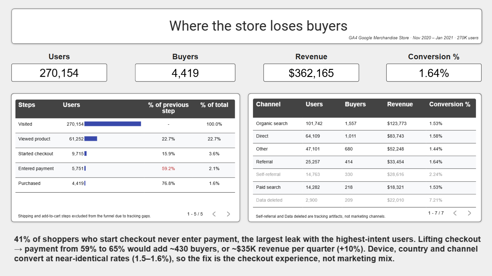
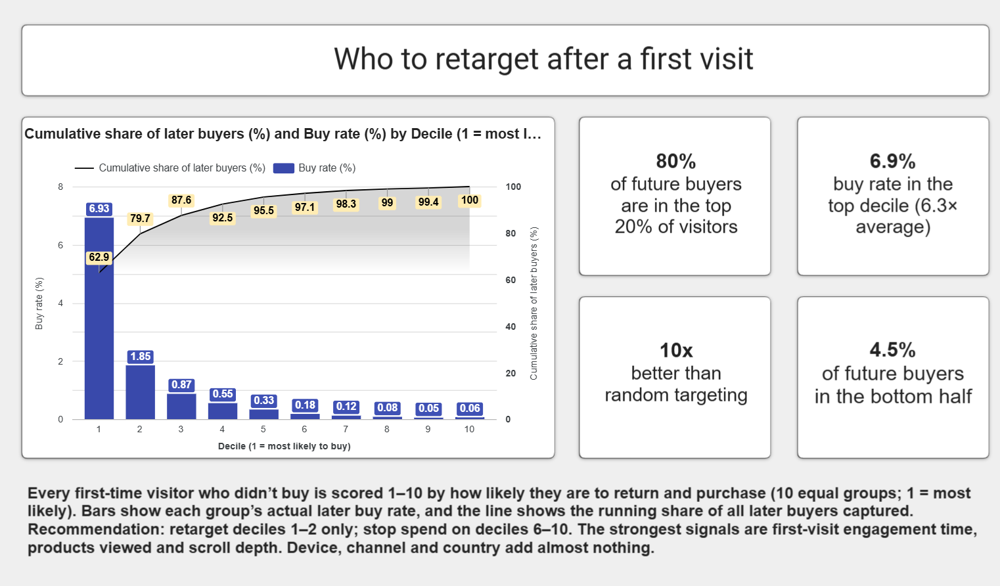

# GA4 E-commerce Funnel: Where Shoppers Drop Off, Who Will Buy, and an AI Weekly Briefing

**Live dashboard:** [Looker Studio](https://datastudio.google.com/reporting/3fbea5f8-3f9b-46e5-8049-f2b38182124d)
**Data:** Google Merchandise Store GA4 sample (`bigquery-public-data.ga4_obfuscated_sample_ecommerce`), 1 Nov 2020 – 31 Jan 2021



**Stack:** BigQuery SQL · Python (pandas, scikit-learn, XGBoost) · Looker Studio · Google Sheets · Gemini API

---

## 1. Business question
An online store converts **1.64% of users** into buyers. Where in the purchase journey are shoppers lost, is the problem marketing (who we attract) or the site (what happens after they arrive), and which new visitors are most likely to buy later?

## 2. Key results
| Question | Answer |
|---|---|
| Biggest leak | **Checkout → payment: only 59.2%** of users who start checkout enter payment details, the largest drop among high-intent users. |
| Size of the prize | Lifting checkout → payment from 59% to 65% ≈ **+433 buyers, ≈ $35.5K per quarter (+9.8% revenue)**. |
| Marketing or site? | **Site.** Device, country and first-touch channel all convert within **1.5–1.6%**. Behaviour (engagement time, product views, scrolling) is what separates buyers. |
| Who will buy later? | A propensity model scored on **first-session behaviour only**: the **top 5% of users capture 46.4% of later buyers (9.3× lift)**; the bottom 50% hold just 4.5%. |
| Weekly reporting | An AI briefing, fact-checked by code, cut weeks with errors from **11 of 12 (plain prompt) to 0 of 12**. |

**Funnel (users, open funnel):** all users → viewed a product **22.7%** → began checkout **15.9%** → added payment **59.2%** → purchased **76.8%**. Overall: 1.64% of users, 1.35% of sessions.

## 3. Data quality: what I found before trusting the numbers
GA4 data is rarely clean. Four issues changed how the funnel was built:
1. **Out-of-order events:** `add_shipping_info` fires *before* `begin_checkout` in 62% of sessions, so it was dropped as a funnel step.
2. **Missing cart events:** 42% of users who began checkout have no `add_to_cart` event, so the cart step is undercounted and excluded from conversion rates. (`view_item_list` is also broken: only 71 events.)
3. **`(data deleted)` traffic source:** a GA4 privacy artifact, shown separately and not treated as a marketing channel.
4. **Self-referral:** traffic "referred" by `shop.googlemerchandisestore.com` itself. Recommendation: add the domain to GA4's unwanted-referrals list.

Two more checks:
- **Revenue tracking gap, week of 25 Jan 2021:** revenue per order fell to **$17.78 vs a typical $73.81** while order volume looked normal. This is treated as a likely tracking problem, not a real collapse.
- **Lesson from a bug:** an early query used `ANY_VALUE()` for channel, which returns an arbitrary row and made paid search look half as good as referral. Switching to first-touch attribution (`ARRAY_AGG … ORDER BY event_timestamp LIMIT 1`) removed the gap, so the claim was retracted.

## 4. Approach
### SQL (BigQuery)
- Sessionised raw events (`UNNEST(event_params)` → `ga_session_id`), built user- and session-level funnels with CTEs.
- Compared open vs closed (in-order) funnels using `MIN(IF(...))` timestamps.
- Built analysis tables (`user_summary`, `weekly_metrics`, `propensity_scores`) and views (`v_funnel` with `UNPIVOT`/`LAG`/`FIRST_VALUE`, `v_gains` with running totals).

### Seasonality
Session conversion peaked at **1.99% (week of 7 Dec)** and bottomed at **0.56% (week of 4 Jan)**, consistent with gift-shipping cutoffs. Checkout → payment rose from about 44% to about 74% across the period, so the $35K estimate uses the period average and may be optimistic if the late-period rate holds.

### Purchase-propensity model (model card)
| | |
|---|---|
| **Target** | User purchases in a *later* session (first-session buyers excluded) |
| **Features** | First session only: page/product views, add-to-cart, searches, promo views, scrolls, began-checkout, engaged seconds, hour, weekday, device, OS, channel, country (top 10 + Other) |
| **Leakage guard** | No information after the first session; users first seen after 31 Dec 2020 excluded so everyone has ≥1 month to convert |
| **Imbalance** | ~1.1% positives; handled with class weights (`scale_pos_weight`), not SMOTE |
| **Models** | Logistic regression (baseline) vs XGBoost; XGBoost won **all 5 stratified CV folds** (paired comparison) |
| **Tuning** | `RandomizedSearchCV` → depth 3, 232 trees, learning rate ≈ 0.027, subsample ≈ 0.63 |
| **Test result** | **PR-AUC 0.111 vs 0.011 baseline (≈10×)**; top 5% capture 46.4% of later buyers; top 2 deciles ≈ 80% |
| **Drivers** | Permutation importance: engagement time, product views, scrolling. Channel and device add little. |
| **Use** | Retarget top-decile first-time visitors; skip spend on the bottom half |

### AI weekly briefing
Managers want a short "what happened this week" note, but LLMs invent numbers and causes. The design keeps the LLM away from the maths:
1. **SQL** computes every number (`weekly_metrics`).
2. **Python** builds a facts packet for each week: week-on-week changes, an "unusual" flag (|z| ≥ 2 vs the trailing 4 weeks, past data only), calendar notes (Black Friday, Christmas) and data-quality warnings.
3. **Gemini** (`gemini-3.5-flash-lite`, temperature 0.2) only writes prose from the facts, under 10 written rules: rates in percentage points, no causes, hedge data issues, and so on.
4. **A code validator** checks every draft: format, every number exists in the facts, up/down words match the data clause by clause, "unusual" claims match the flags, no invented causes, no leaked instructions, data issues hedged. Failed drafts are retried with the errors (up to 2 times), then replaced by a fixed template.

**Evaluation (12 weeks, same model, same facts):**
| Error type | Plain prompt | Rules + validator |
|---|---|---|
| Invented causes ("driven by", "due to") | 19 | 0 |
| Rate change given as relative % instead of points | 8 | 0 |
| Unverified "unusual" claim | 1 | 0 |
| Data issue stated as certain | 1 | 0 |
| **Weeks with ≥1 error** | **11 / 12** | **0 / 12** |

Final pipeline: 11 weeks passed (some after a retry), 1 week used the template fallback.

## 5. Limitations (read before reusing)
- **Obfuscated sample data:** Google modified this dataset, so absolute values are illustrative.
- **Test-set reuse:** models were compared on the test set during development, so the 0.111 PR-AUC may be slightly optimistic.
- **The validator was refined after reading these 24 summaries,** so it is tuned to errors already seen. Its 0/12 is not a guarantee on new weeks. Manual review is still advised.
- **Validator blind spots:** swapped numbers (both valid), omitted key movements, synonyms ("traffic" for sessions). Every fix exposed the next blind spot. For example, an early date-matching rule flagged "declined" as a date.
- **Layered checks matter:** the z-score rule *missed* the −79% revenue drop (the trailing weeks were too volatile), but the revenue-per-order rule caught it.
- **Replayed weeks:** briefings were generated retrospectively for historical weeks, not live.

## 6. Repository layout
```
sql/                     BigQuery queries, numbered in the order they were run
notebooks/
  propensity_model.ipynb     model training, CV, tuning, deciles
  ai_weekly_briefing.ipynb   facts builder, Gemini prompt, validator, evaluation
data/                    small outputs only (weekly metrics, briefings, evaluation)
images/                  dashboard screenshots
requirements.txt
```

## 7. How to reproduce
1. Create a free Google Cloud project and open the BigQuery sandbox (no billing needed).
2. Run the files in `sql/` in order; they create the `ga4_funnel` dataset tables and views.
3. Open the notebooks in Google Colab, set `PROJECT_ID`, and add a free Gemini API key to **Colab Secrets** as `GEMINI_API_KEY`.
4. The API key is read with `userdata.get("GEMINI_API_KEY")` and is **never** stored in code or in this repository.
